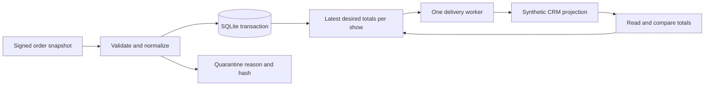

# Ticket Sync Lab

A TypeScript service that keeps a CRM's event totals consistent with ticket orders and partial refunds, including when messages repeat, arrive late, or fail halfway through delivery.

Two runnable integrations live here: a ticketing-to-CRM failure exercise using synthetic contracts, and a real WordPress REST feed with optional Resend change notifications. Both use original code. No customer data or private employer code is included.

Start with the [live feed guide](docs/live-feed.md) to fetch public WordPress metadata without credentials. The new services in this repository are not yet deployed in production.

## Run the demonstration

Use **Node.js 24.12 or newer within the 24.x LTS line**. The synthetic demo has no runtime dependencies, API keys, accounts, or cloud charges.

```sh
git clone https://github.com/johnclyde/ticket-sync-lab.git
cd ticket-sync-lab
npm run demo
```

The demo starts two loopback HTTP servers, sends signed synthetic webhooks, and asserts each outcome. It uses a temporary SQLite database and removes it when finished. It advances an injected clock to test retry windows without making you wait.

1. Reject a bad signature and accept an order exactly once locally.
2. Apply a partial refund in a changed feed format; ignore an older order snapshot.
3. Quarantine an unknown schema without changing valid totals.
4. Fail CRM delivery with HTTP 503, restart the integration, then encounter HTTP 429. Preserve the queue and honor `Retry-After`.
5. Repair a deliberately corrupted CRM total. Drop the response after the CRM commits, then retry the same idempotency key without a second write.
6. Surface a stale input stream and quarantined data in operator status.

The final projection contains **2 orders, 5 net tickets, and $250.00**. All money is stored as integer cents. The last health sample is deliberately stale because the final drill advances the clock beyond the freshness threshold.

## Why the model matters



An order carries its own increasing revision and cumulative sold/refunded quantities. A newer snapshot replaces the earlier one; totals are recomputed from those orders. An old revision cannot reverse a refund. A repeated delivery cannot increment sales a second time. Reusing a delivery ID or order revision with conflicting content is quarantined.

Each accepted order, its receipt, and the pending CRM update commit in one transaction before the webhook returns HTTP 202. Multiple updates to a show coalesce into the latest desired totals. The worker sends an absolute projection, not an increment, using `showId:version` as its idempotency key.

This is **at-least-once delivery**. The synthetic destination enforces both idempotency keys and increasing projection versions. A real destination adapter must provide equivalent behavior or reconciliation appropriate to that vendor. There is no distributed transaction between SQLite and the CRM.

The failure policy is deliberate:

- HTTP 408, 429, 5xx, timeouts, and connection failures retry with exponential backoff.
- `Retry-After` is honored up to 24 hours; the eighth failed attempt blocks the show.
- Other non-success responses block immediately.
- New order traffic preserves backoff, failed-attempt counts, and blocked status. It cannot bypass a rate limit.
- An older in-flight success cannot acknowledge newer work. An in-flight failure still constrains newer pending work for the same show.
- A corrected request following a terminal error requires an authenticated operator retry. Restarting does not silently reset it.
- Reconciliation requeues drift for known shows and leaves unrelated CRM records alone. It does not reset pending or blocked work.

See [the walkthrough](docs/walkthrough.md) for the feed change and recovery sequence.

## Verify

```sh
npm ci
npm run check
npm test
npm run demo
```

TypeScript runs directly through Node's type stripping. `npm ci` installs the pinned development-only type checker and Node declarations. Tests use the built-in test runner, temporary databases, a fake clock, and local HTTP servers. No live vendor credentials are required.

## Run as a service

The service requires four explicit settings:

| Setting | Purpose |
| --- | --- |
| `WEBHOOK_SECRET` | At least 32 characters; verifies signed ticket webhooks |
| `ADMIN_TOKEN` | Separate value of at least 32 characters; protects operator endpoints |
| `CRM_URL` | Destination implementing the synthetic contract; HTTPS except for loopback development |
| `CRM_TOKEN` | Bearer credential for that destination |
| `DATA_PATH` | Optional, defaults to `./data/tickets.sqlite` |
| `HOST`, `PORT` | Optional, default to `127.0.0.1:8080` |

Generate independent secrets with `node -e "console.log(require('node:crypto').randomBytes(32).toString('hex'))"`. Inject them through the environment or a secret manager. Then run `npm start`. The service delivers due work every second and checks CRM drift every minute.

| Endpoint | Behavior |
| --- | --- |
| `POST /webhooks/tickets` | Signed JSON, 64 KiB limit, five-minute timestamp window |
| `GET /healthz` | Aggregate operational status; HTTP 503 for stale/empty/retrying/blocked state or a worker error |
| `GET /status` | Bearer-protected totals, delivery status, retry timing, and safe error codes |
| `POST /admin/reconcile` | Bearer-protected immediate drift check |
| `POST /admin/retry` | Bearer-protected explicit retry of a blocked show; body `{"showId":"show-spring"}` |

Webhook headers are `X-Ticket-Timestamp` (Unix seconds) and `X-Ticket-Signature` (hex HMAC-SHA256 of `timestamp + '.' + rawBody`). The mock source contract is documented in [fixtures.ts](src/fixtures.ts); production providers have their own signing rules.

Quarantine records contain a hash, a reason, and timestamps, rather than the rejected body. Quarantine counts remain visible in status, but do not alone make the health endpoint fail. The operator should alert on an increase and recover the original event from the source after fixing its adapter.

## Container

```sh
docker build -t ticket-sync-lab .
docker run --rm ticket-sync-lab node src/demo.ts
```

The image runs as a non-root user. For the long-running service, inject the four settings and mount a persistent volume at `/app/data`.

## Deployment boundary

This version is intentionally a **single process with one delivery worker and durable local SQLite storage**. Do not deploy it as multiple replicas or rely on ephemeral Cloud Run disk. There are no cross-process worker leases. A cloud deployment would first need a managed database/outbox and coordinated workers, or a single-instance host with durable storage.

The five-minute freshness signal measures **time since a newly accepted order snapshot**. A quiet event stream can therefore look stale. A real provider adapter should use a successful poll watermark or source heartbeat and a business-specific freshness threshold. `/healthz` exposes the signal; no external alerting service is configured here.

Other deliberate limits: one source namespace, USD only, bounded nonnegative amounts, no pagination in the synthetic CRM snapshot, no production ingress rate limiter, and no historical order deletion. Source-side reconciliation, provider authentication/OAuth, retention, schema migrations, and backup/restore procedures are future work. The current reconciliation repairs destination drift; it cannot discover an order whose source webhook never arrived.

MIT licensed. Development notes and remaining work live in [docs/work-log.md](docs/work-log.md).
